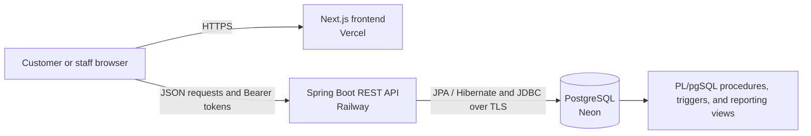

<div align="center">


# KandyPack Rail & Road Logistics System

**From Kandy to your business — coordinated ordering, rail allocation, and road delivery.**

A full-stack academic group project that brings customer ordering, transport planning, database automation, and management reporting into one logistics platform.


[Live Application](https://kandy-pack-frontend.vercel.app) · [Backend API](https://kandypackrailroadlogisticsystem-production.up.railway.app/api/products) · [Team & Contributions](#team--contributions) · [Local Setup](#local-setup)

</div>

---

## Overview

KandyPack models the distribution of goods from Kandy to regional destinations using rail transport followed by road delivery. Customers select products and delivery routes, while staff coordinate train capacity, trucks, drivers, and assistants. PostgreSQL procedures and triggers enforce allocation, delivery, and rostering rules alongside the Spring Boot application.

The project combines a customer storefront with staff tools for planning deliveries and reviewing operational performance. The frontend and backend share this repository and deploy independently, with a PostgreSQL database hosted on Neon.

## Features

| Area | Capabilities |
| --- | --- |
| Customer accounts | Registration, login, JWT sessions, and access to the customer's own order history |
| Product catalogue | Product search, illustrated product cards, quantities, and calculated order totals |
| Order placement | Delivery-route selection, seven-day minimum lead time, and transactional order creation |
| Rail allocation | Trip capacity reservations, item allocations across suitable trips, and allocation details in order responses |
| Train planning | Staff forms for creating future train trips with destination stores and cargo capacity |
| Road dispatch | Truck, route, driver, assistant, time-window, and whole-order assignment |
| Staff dashboard | Order search, status filters, record counts, status updates, and order CSV export |
| Management reports | Quarterly sales, popular products, city/route sales, crew hours, truck usage, and customer delivery history |
| Database integrity | Foreign keys, native enums, checks, transactional allocation, reservation guards, and roster constraints |
| User experience | Responsive layouts, loading feedback, validation messages, retry controls, and cancellation confirmation |

## Architecture



The Next.js client components call the backend directly using `NEXT_PUBLIC_API_URL`. Spring Security validates JWTs and applies endpoint role restrictions. JPA handles entity persistence, while JDBC calls connect application workflows to database procedures and reporting views. The database is responsible for enforcing its allocation and dispatch rules within transactions.

## Technology Stack

Versions below reflect the checked-in manifests. Dependencies without explicit versions are managed by Spring Boot or the relevant package version range.

| Layer | Technologies | Purpose |
| --- | --- | --- |
| Frontend framework | Next.js **16.3.5**, App Router | Routing, layouts, production builds, and frontend delivery |
| UI library | React **19.2.8**, React DOM **19.2.8** | Interactive forms, state, and reusable components |
| Frontend language | TypeScript **5.x** | Typed page, component, and API response code |
| Styling | Tailwind CSS **4.x**, CSS, PostCSS | Responsive page styling and shared visual design |
| Frontend tooling | Node.js, npm, ESLint **9.x**, eslint-config-next **16.3.5** | Dependency installation, builds, and linting |
| Backend language | Java **21** | Application and business logic |
| Backend framework | Spring Boot **4.1.1**, Spring Web MVC | REST controllers and application configuration |
| Data access | Spring Data JPA, Hibernate ORM, Spring JDBC / JdbcTemplate, PostgreSQL JDBC driver, HikariCP | Entity mappings, repositories, transactions, SQL, procedure calls, and connection pooling |
| Authentication | Spring Security, JJWT **0.12.6**, BCrypt | Bearer-token authentication, role checks, and password hashing |
| Validation | Jakarta Bean Validation | Validation of annotated request DTOs |
| API documentation | springdoc-openapi **3.1.1**, Swagger UI | Generated API documentation |
| Database | PostgreSQL **18**, PL/pgSQL | Relational storage, native enums, functions, procedures, triggers, and views |
| Backend build | Maven Wrapper, Spring Boot Maven Plugin | Repeatable compilation, tests, and executable JAR packaging |
| Automated testing | JUnit Jupiter, Spring Boot Test | Startup and database integration tests |
| Browser verification | Playwright, Chromium-based browser | Deployed-page, layout, network, CORS, and form checks; audit tooling is maintained outside the repository |
| Containers | Docker, Docker Compose, Eclipse Temurin, Node Alpine images | Local services and backend container builds |
| Hosting | Vercel, Railway, Neon | Frontend, backend, and managed PostgreSQL hosting |
| Collaboration | Git, GitHub | Version control, branches, and shared development |

## Team & Contributions

| Student Index | Member | Contributions |
| --- | --- | --- |
| **240057U** | **Malith Bandara** | Database relationships and integrity constraints; JPA entities, repositories, DTOs, and data-access controllers; dispatch/train API integration; frontend usability, product assets, cancellation confirmation, and final project integration. |
| **240553L** | **Binura Yeshan** | Order assignment service and order controllers; allocation procedures and PL/pgSQL automation; reservation, capacity, status, resource-conflict, and crew-hour rules; dispatch controller, delivery-planning/trip pages, and storefront/hero updates. |
| **240252M** | **Isaiyalan Kajenthiran** | Customer and staff authentication; signup/login endpoints; JWT generation, validation, and filtering; Spring Security and role-based access; login/signup forms, API connections, session storage, and authentication feedback. |
| **240612T** | **Sesathviiyaa Ragavan** | Reporting SQL and related indexes; staff dashboard, reporting and CSV updates; frontend integration and login feedback; Docker/deployment configuration, dependency configuration, and project setup documentation. |
| **240361V** | **Himash Ravisha** | Initial logistics, product, account, schedule, and routing schema work; transactional tables and primary keys; Next.js layout/configuration foundations; customer storefront, order forms/history, responsive navigation, and shared theme updates. |

Contribution summaries reflect the repository history and project documentation. Several areas were developed collaboratively and refined during integration; the table describes areas of work rather than exclusive ownership.

## Repository Structure

```text
Kandy_Pack_Rail_Road_Logistic_System/
├── README.md
├── .env.example                     # Local Docker password template
├── docker-compose.yml               # Local PostgreSQL, backend, and frontend
├── database/
│   ├── docker-init.sql              # Fresh Docker database initialization
│   ├── migrate-neon.ps1             # Empty-database Neon setup helper
│   └── migrations/
│       ├── 01_enums.sql
│       ├── 02_tables_and_indexes.sql
│       ├── 03_functions.sql
│       ├── 04_procedures.sql
│       ├── 05_views_and_reports.sql
│       ├── 06_foreign_keys.sql
│       ├── 07_triggers.sql
│       ├── run_all.psql             # Ordered, transactional baseline runner
│       └── README.md
├── docs/                            # Design notes, reviews, and project documents
├── kandypack-frontend/
│   ├── app/
│   │   ├── components/              # Navigation, branding, feedback, and dialogs
│   │   ├── lib/                     # API response helpers
│   │   ├── login/ & signup/
│   │   ├── orders/ & dashboard/
│   │   ├── dispatch/ & trips/
│   │   └── reports/
│   ├── public/                      # Brand and product assets
│   ├── package.json
│   └── Dockerfile
└── kandypackbackend/
    ├── src/main/java/com/kandypack/kandypackbackend/
    │   ├── controller/
    │   ├── dto/
    │   ├── entity/
    │   ├── exception/
    │   ├── repository/
    │   ├── security/
    │   └── service/
    ├── src/main/resources/application.properties
    ├── src/test/java/
    ├── .mvn/ & mvnw.cmd
    ├── pom.xml
    └── Dockerfile
```

Historical database snapshots may exist locally but are excluded by the root ignore rules. The numbered baseline is the schema setup source for a fresh database.

## Local Setup

### Prerequisites

- Git.
- Java **21** and a correctly configured `JAVA_HOME` for running the backend locally.
- Node.js **20.9 or newer** and npm; use a supported Node.js release compatible with the checked-in frontend dependencies.
- PostgreSQL **18**, or a Neon database, with the application schema and required reference data.
- Docker Desktop using Linux containers for the Docker setup and Neon migration helper.

The commands below use Windows PowerShell. The Maven Wrapper downloads Maven when necessary; a separate global Maven installation is optional.

### 1. Clone the repository

```powershell
git clone https://github.com/Database-Project-G21/Kandy_Pack_Rail_Road_Logistic_System.git
cd Kandy_Pack_Rail_Road_Logistic_System
```

### 2. Configure the backend

Create `kandypackbackend/.env` with your own values:

```dotenv
SPRING_DATASOURCE_URL=jdbc:postgresql://YOUR_DATABASE_HOST:5432/YOUR_DATABASE?sslmode=require&channelBinding=require
SPRING_DATASOURCE_USERNAME=YOUR_DATABASE_ROLE
SPRING_DATASOURCE_PASSWORD=YOUR_DATABASE_PASSWORD
JWT_SECRET=REPLACE_WITH_A_PRIVATE_RANDOM_SECRET_OF_AT_LEAST_32_UTF8_BYTES
CORS_ALLOWED_ORIGINS=http://localhost:3000
```

The JDBC example is for a TLS-enabled database such as Neon. For a local PostgreSQL instance without TLS, use a connection URL such as `jdbc:postgresql://localhost:5432/kandypack`.

Generate a private JWT secret and copy it to your clipboard:

```powershell
$secretBytes = New-Object byte[] 32
$generator = [System.Security.Cryptography.RandomNumberGenerator]::Create()
$generator.GetBytes($secretBytes)
[Convert]::ToBase64String($secretBytes) | Set-Clipboard
$generator.Dispose()
```

Paste the generated value into `JWT_SECRET`. Environment files are ignored by Git. The backend reads its optional `.env` relative to its working directory, so run Maven from `kandypackbackend/`.

### 3. Prepare the database

For an **empty Neon database**, configure the backend `.env`, start Docker Desktop, and run from the repository root:

```powershell
powershell -ExecutionPolicy Bypass -File .\database\migrate-neon.ps1
```

The helper checks for existing tables in the public schema and refuses to overwrite them. It executes `run_all.psql`, which loads all seven SQL files in one transaction and stops on errors.

For a local empty database, configure the standard `psql` connection environment variables, then run:

```powershell
psql -X -v ON_ERROR_STOP=1 -f .\database\migrations\run_all.psql
```

**The baseline creates schema objects only.** Populate reference and operational setup data separately before using the application: cities, stores, routes, products, trains, trucks, drivers, assistants, a staff account, and the `kp_roster_mutex` singleton used for dispatch synchronization. Existing historical snapshots contain data but are not interchangeable with the enum-based baseline; review any data import separately.

An already initialized database must not be initialized again. This is a manual baseline runner, not an incremental migration framework; `kp_migration` does not make these files automatically rerunnable. Hibernate uses `ddl-auto=validate` and does not create or upgrade the schema.

See [Database setup](database/migrations/README.md) for the file order and connection instructions.

### 4. Start the backend

In one PowerShell window:

```powershell
cd kandypackbackend
.\mvnw.cmd spring-boot:run
```

The backend listens on **http://localhost:8081** by default.

### 5. Start the frontend

Create `kandypack-frontend/.env`:

```dotenv
NEXT_PUBLIC_API_URL=http://localhost:8081
```

In another PowerShell window, starting at the repository root:

```powershell
cd kandypack-frontend
npm.cmd ci
npm.cmd run dev
```

Open **http://localhost:3000**. Register a customer against an existing delivery city, or sign in with an existing account. Initial staff access must be provisioned separately; the staff-signup API requires an administrator.

## Run with Docker Compose

From the repository root:

```powershell
Copy-Item .env.example .env
# Edit the new root .env and set KANDYPACK_DB_PASSWORD.
docker compose up --build -d
docker compose logs -f backend
```

If a root `.env` already exists, edit it instead of copying over it. For an existing database volume, use the database's current password; changing the variable does not reset a stored database password.

| Service | Local address |
| --- | --- |
| Frontend | http://localhost:3000 |
| Backend | http://localhost:18081 |
| PostgreSQL | localhost:5432 |

The backend container listens internally on `8081`; Compose publishes it on host port `18081`. The frontend Docker build receives that host API URL. If you run the frontend development server against the Docker backend, set its `NEXT_PUBLIC_API_URL` to `http://localhost:18081`.

Compose starts a **local database**, independently of Neon. Its initialization loads the schema only when PostgreSQL creates a fresh data directory. Reference data still needs to be supplied. The backend image excludes local `.env` files and receives database settings from Compose. For stable local Docker sessions, supply a private `JWT_SECRET` to the backend service as well.

To stop services while keeping database data:

```powershell
docker compose down
```

Avoid `docker compose down -v` unless you intend to delete the local database volume.

## Configuration Reference

| Variable | Component | Description |
| --- | --- | --- |
| `NEXT_PUBLIC_API_URL` | Frontend | Backend origin, without `/api` or a trailing slash; embedded at frontend build time |
| `SPRING_DATASOURCE_URL` | Backend | PostgreSQL JDBC URL; preserve TLS options for Neon |
| `SPRING_DATASOURCE_USERNAME` | Backend | PostgreSQL connection role |
| `SPRING_DATASOURCE_PASSWORD` | Backend | Database password; keep private |
| `JWT_SECRET` | Backend | Private, stable signing secret containing at least 32 UTF-8 bytes |
| `CORS_ALLOWED_ORIGINS` | Backend | Comma-separated allowed frontend origins, without trailing slashes |
| `SERVER_PORT` | Backend | Overrides the default Spring Boot port, `8081` |
| `PORT` | Railway | Platform routing/health-check port; keep aligned with the server configuration |
| `KANDYPACK_DB_PASSWORD` | Local Compose | Local PostgreSQL password passed to the database and backend containers |

Only public frontend configuration belongs in `NEXT_PUBLIC_*` variables. Database credentials and JWT signing secrets belong exclusively in private backend configuration. Changing a public Next.js variable requires rebuilding/redeploying the frontend.

## Database Design & Business Rules

The baseline defines **20 tables**, **two native enum types**, **three ordinary helper functions**, **three procedures**, **seven reporting views**, and **ten trigger bindings**. Trigger functions include additional retained legacy definitions; a defined function does not necessarily have an active trigger binding.

| Domain | Main tables |
| --- | --- |
| Accounts and geography | `customer`, `staff_user`, `city` |
| Catalogue and orders | `product`, `customer_order`, `order_item` |
| Rail transport | `train`, `train_schedule`, `order_travel`, `order_trip_item` |
| Road transport | `store`, `route`, `truck`, `driver`, `assistant`, `truck_dispatch`, `order_dispatch` |
| Internal coordination | `kp_legacy_fulfilment`, `kp_migration`, `kp_roster_mutex` |

Core rules implemented by the application and database include:

- Delivery dates at least **seven days** after placement, using Sri Lanka business dates in the ordering service.
- Delivery routes aligned with the customer's delivery city.
- Capacity reservations based on product space and quantity, within the order/allocation transaction.
- Reservation changes and eligible cancellations handled through database rules.
- Valid order-state transitions between `placed`, `scheduled`, `dispatched`, `delivered`, and `cancelled`.
- No overlapping assignments for the same truck, driver, or assistant.
- At least a **one-hour break** between driver deliveries and after at most two consecutive assistant routes.
- Weekly scheduled-hour limits of **40 hours for drivers** and **60 hours for assistants**.
- Truck/store/route consistency and route-duration limits.

### Reporting

The reporting API provides quarterly sales, top items, city/route sales, weekly crew hours, monthly truck usage, and customer delivery history. The database views also expose driver/assistant hours and truck utilization. Staff can export dashboard orders and loaded management reports as CSV.

## API Reference

Base path: `/api`. Protected requests send `Authorization: Bearer <token>`.

| Method | Endpoint | Purpose / access |
| --- | --- | --- |
| `POST` | `/auth/signup` | Register a customer |
| `POST` | `/auth/login` | Authenticate a customer or staff member |
| `POST` | `/auth/staff-signup` | Create staff accounts; administrator only |
| `GET` | `/products`, `/products/{id}` | Public product catalogue |
| `GET` | `/routes`, `/routes/{id}` | Public delivery-route lookup |
| `GET` | `/trains`, `/trains/{id}` | Public train-trip lookup |
| `GET` | `/trains/options` | Train/store options; administrator or dispatcher |
| `POST` | `/trains` | Create a trip; administrator or dispatcher |
| `POST` | `/orders` | Place an order as an authenticated customer |
| `GET` | `/orders/my` | Current customer's order history |
| `GET` | `/orders` | Staff order listing |
| `GET` | `/orders/{id}` | Authorized staff or the owning customer |
| `PUT` | `/orders/{id}/status` | Status updates; administrator, dispatcher, or driver |
| `GET` | `/orders/export/csv` | Order export; administrator or dispatcher |
| `GET` | `/dispatches`, `/dispatches/options` | Dispatch records/options; administrator or dispatcher |
| `POST` | `/dispatches` | Create a dispatch; administrator or dispatcher |
| `GET` | `/reports/{report}` | Management reports; administrator or dispatcher |
| `GET` | `/customers` | Customer listing; administrator only |
| `GET` | `/customers/{id}` | Administrator or the owning customer |

When enabled, generated API documentation is available at `/swagger-ui.html` and `/v3/api-docs`. The controller annotations and request DTOs are the reference for detailed permissions and payloads.

## Deployment

One GitHub repository supplies two independently deployed services:

| Component | Platform | Service root | Public address |
| --- | --- | --- | --- |
| Frontend | Vercel | `kandypack-frontend` | [kandy-pack-frontend.vercel.app](https://kandy-pack-frontend.vercel.app) |
| Backend | Railway | `/kandypackbackend` | [kandypackrailroadlogisticsystem-production.up.railway.app](https://kandypackrailroadlogisticsystem-production.up.railway.app/api/products) |
| Database | Neon | Managed PostgreSQL database | Private connection configuration |

### Railway backend

1. Connect the repository and select `main`.
2. Set the root directory to `/kandypackbackend`; Railway uses the existing Dockerfile.
3. Configure the three `SPRING_DATASOURCE_*` variables for the initialized Neon database.
4. Set a private `JWT_SECRET`, `SERVER_PORT=8081`, and `PORT=8081`.
5. Set `CORS_ALLOWED_ORIGINS=https://kandy-pack-frontend.vercel.app`, or your own exact frontend origin.
6. Generate a public domain targeting port `8081`, then verify `/api/products`.

### Vercel frontend

1. Import the same repository, select `main`, and use the Next.js framework preset.
2. Set Root Directory to `kandypack-frontend` and keep the framework build defaults.
3. Set `NEXT_PUBLIC_API_URL` to the backend's HTTPS origin.
4. Deploy. Redeploy whenever that public API variable changes.

For additional frontend domains, explicitly add each trusted origin to the backend CORS configuration. Local Docker Compose configuration is separate from these hosted service settings. Baseline migrations are not executed automatically when the backend starts.

## Testing & Verification

### Frontend checks

```powershell
cd kandypack-frontend
npm.cmd ci
npm.cmd run lint
npx.cmd tsc --noEmit
npm.cmd run build
```

### Backend checks

```powershell
cd kandypackbackend
.\mvnw.cmd test-compile
.\mvnw.cmd test
```

The startup test requires a reachable, initialized database configured through the backend environment. `EnumMappingIntegrationTests` is opt-in: point the datasource at a **disposable database** containing the current schema and representative data, then run:

```powershell
$env:KP_ENUM_TEST_DATABASE = 'true'
try {
    .\mvnw.cmd test
} finally {
    Remove-Item Env:KP_ENUM_TEST_DATABASE
}
```

The enum tests cover staff-role persistence, order-status persistence/cancellation, invalid enum labels, and report status serialization. Their data changes are transactional and roll back. Do not run them against the shared production database.

### Deployment smoke checks

Browser verification has covered login/signup rendering, required-field validation, desktop/mobile/tablet layouts, unauthenticated route redirects, unknown-page handling, public backend data, CORS, and the invalid-login response. A subsequent live check confirmed that Vercel calls Railway, the catalogue endpoint returns product data, and invalid credentials produce HTTP `401` with a readable error.

These checks do not establish every authenticated business workflow. Validate successful customer/staff login, order creation, capacity allocation, cancellation, dispatch creation, status transitions, and exports using dedicated test accounts and a suitable test environment. Playwright audit scripts are not currently part of this repository's npm scripts or CI.

## Development & Collaboration

- Branch from the current `main` for new work, using names such as `feature/order-validation` or `fix/dispatch-filter`.
- Keep commits focused and submit a pull request describing the behavior change and relevant validation.
- Preserve shared Git history; avoid rewriting `main` for normal updates.
- Commit source, manifests, lockfiles, and reviewed schema changes. Keep credentials, database backups, dependencies, and generated output outside version control.
- Review SQL changes against the current baseline and coordinate any migration to an existing database separately.

## Project Documentation

- [Database baseline and migration instructions](database/migrations/README.md)
- [Database and JPA contribution notes](docs/PERSON3_DATABASE_JPA.md)
- [PL/pgSQL automation contribution notes](docs/PERSON4_DB_AUTOMATION.md)
- [Codebase review](docs/CODEBASE-REVIEW.md)
- [Frontend design notes](kandypack-frontend/REDESIGN-NOTES.md)
- [Project summary](docs/kandypack_project_summary.md.pdf)
- [Project schedule](docs/project_schedule.md.pdf)

Some design/review documents describe earlier snapshots. Use the current source, manifests, and numbered SQL baseline when older paths, table counts, or setup instructions differ.

## License

This repository does not currently include a license file. Contact the project team about permission to reuse or redistribute its code and assets.

---

<div align="center">

**KandyPack — Rail capacity, road coordination, and delivery visibility in one platform.**

Developed collaboratively by Malith Bandara, Binura Yeshan, Isaiyalan Kajenthiran, Sesathviiyaa Ragavan, and Himash Ravisha.

</div>
